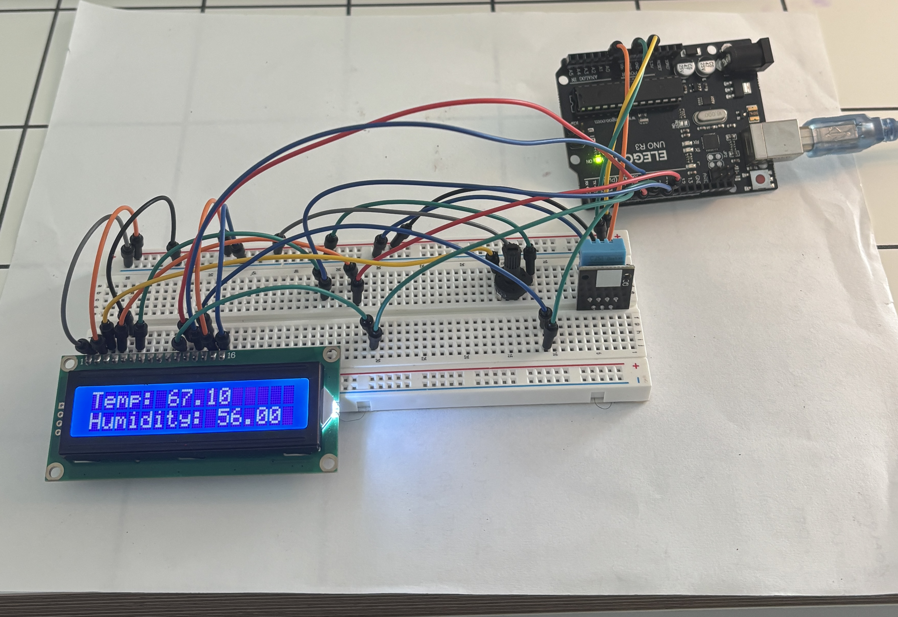
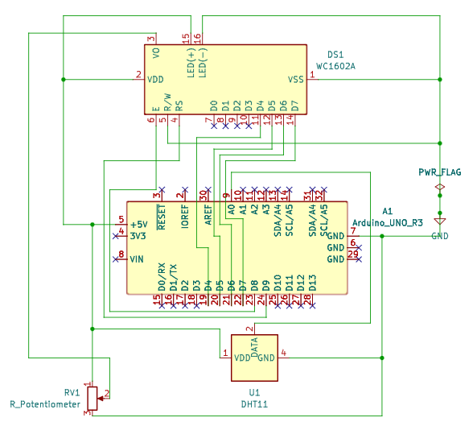
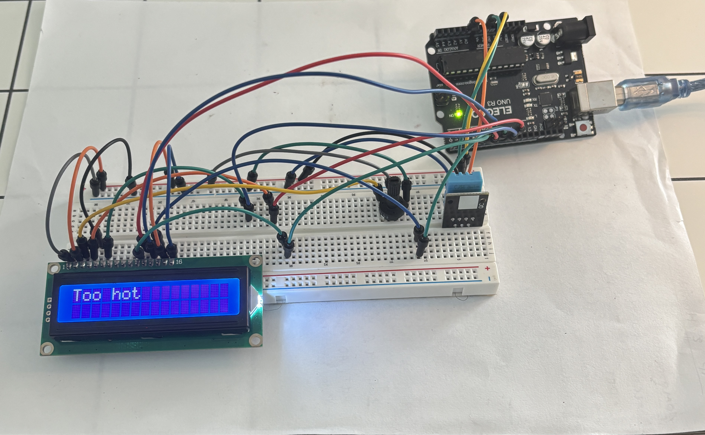
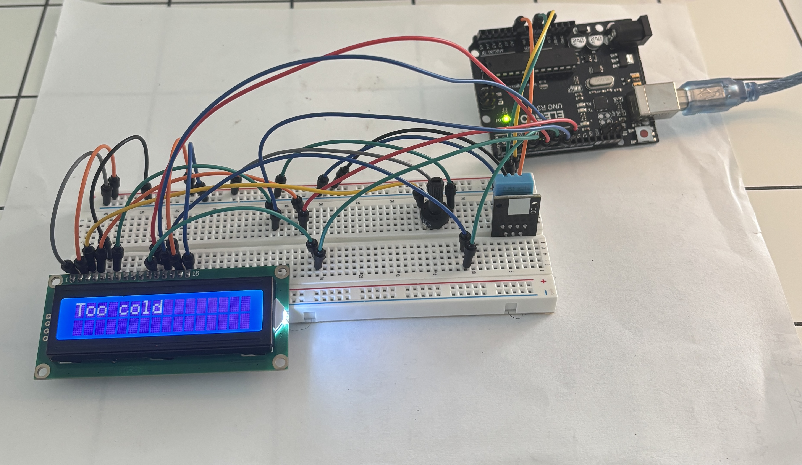

# Arduino Temperature and Humidity Monitor

An Arduino Uno project that measures room temperature and humidity using a DHT11 sensor and displays the readings on a 16x2 LCD. The system also displays alerts when the temperature exceeds configured thresholds. Each valid reading is also sent over USB serial, and a Python script can save the readings to a timestamped CSV file.



## Features

- Displays temperature in Fahrenheit (°F)
- Displays relative humidity as a percentage
- Displays **"Too hot"** when the temperature exceeds 80°F
- Displays **"Too cold"** when the temperature falls below 60°F
- Displays an error message if a sensor reading fails
- Sends each valid reading over serial as `temperature,humidity`
- Includes a Python logger that saves the serial readings to a CSV file with timestamps

## Hardware

- Arduino Uno
- DHT11 temperature and humidity sensor module
- 16x2 LCD1602 display
- Potentiometer for LCD contrast adjustment
- Breadboard and jumper wires

## Wiring

| Component | Pin | Arduino Connection |
|---|---|---|
| LCD | RS | Digital pin 9 |
| LCD | E | Digital pin 8 |
| LCD | D4 | Digital pin 4 |
| LCD | D5 | Digital pin 5 |
| LCD | D6 | Digital pin 6 |
| LCD | D7 | Digital pin 7 |
| LCD | RW | GND |
| LCD | VSS | GND |
| LCD | VDD | 5V |
| LCD | VO | Potentiometer middle pin |
| LCD | A (backlight) | 5V |
| LCD | K (backlight) | GND |
| DHT11 | Data | A0 |
| DHT11 | VCC | 5V |
| DHT11 | GND | GND |
| Potentiometer | Outer pins | 5V and GND |

## Circuit Schematic

The circuit schematic was created in KiCad to document the hardware connections.



The `kicad` folder contains the editable KiCad project files and a PDF version of the schematic.

## Software

- **Arduino IDE** — for writing and uploading the program
- **DHT sensor library by Adafruit** — for reading temperature and humidity
- **Adafruit Unified Sensor** — dependency required by the DHT library
- **LiquidCrystal** — library included with the Arduino IDE for controlling the LCD
- **Python 3** — for running the data logger
- **pyserial** — Python library for reading from the Arduino's serial port

### Arduino Sketch

The source code is available here:

[`temperature_humidity_monitor/temperature_humidity_monitor.ino`](temperature_humidity_monitor/temperature_humidity_monitor.ino)

The sketch prints each valid reading to serial at 9600 baud, one line per reading, in the format `temperature,humidity` (for example, `67.46,59.00`). Failed sensor readings are not printed.

## Data Logging

The Python script [`logger.py`](logger.py) reads the serial output from the Arduino and appends each reading to `log.csv`, with a timestamp.

To run it:

1. Upload the sketch to the Arduino.
2. Close the Arduino IDE Serial Monitor, since only one program can use the port at a time.
3. Install pyserial:

```
   python -m pip install pyserial
```

4. In `logger.py`, set the port name to match your Arduino (it is `COM3` on my Windows PC; check **Tools → Port** in the Arduino IDE).
5. Run the logger:

```
   python logger.py
```

6. Press **Ctrl+C** to stop it.

Each row in `log.csv` is one reading with three columns: the timestamp (`YYYY-MM-DDTHH:MM:SS`, from the computer's clock), the temperature in °F, and the relative humidity in %. For example:

```
2026-10-20T13:46:33,66.74,60.00
```

The file has no header row, and new readings are appended to the end each time the logger runs. If `log.csv` is open in Excel, close it before starting the logger, because Excel locks the file.

## Demonstration

### Normal Operation

The LCD displays the current temperature and relative humidity.


### High-Temperature Alert

The LCD displays an alert when the temperature exceeds 80°F. This photo was taken by actually heating the sensor.



### Low-Temperature Alert

The LCD displays an alert when the temperature falls below 60°F. This photo was taken by actually cooling the sensor.



## Development Notes

- Built the initial circuit in September 2026 and revisited the project in October 2026.
- Resolved an initial pin conflict by moving the DHT11 data connection to A0.
- Created a KiCad schematic to document the circuit design.
- Added serial output to the sketch and wrote a Python logger with pyserial in October 2026. Tested on Windows.
- Added timestamps to the logged readings.

## Current Status

- Arduino circuit assembled and operational.
- LCD temperature, humidity, and alert displays implemented.
- KiCad schematic created and project files documented.
- Serial output and timestamped Python CSV logger working.
- Custom PCB not yet designed.

## Future Improvements

- Add adjustable temperature thresholds.
- Plot the logged data.
- Design a custom PCB.
- Build multiple monitoring units for different rooms.
